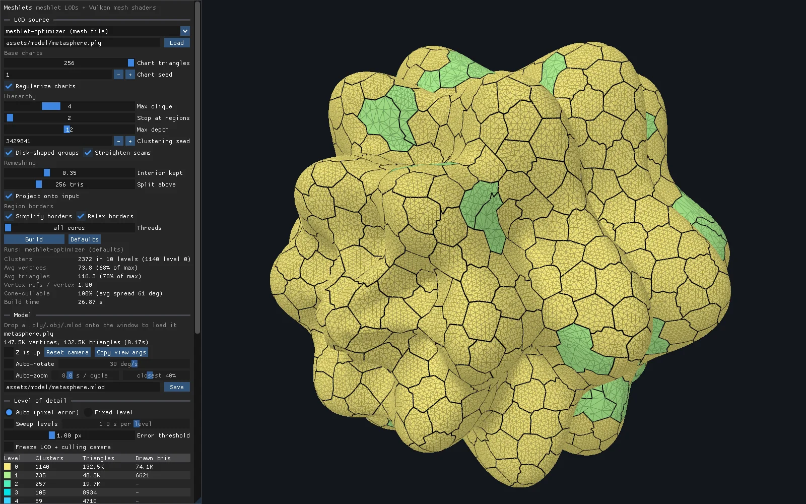

# meshlets

Interactive meshlet viewer: loads a PLY/OBJ model, splits it into meshlets with
[meshoptimizer](https://github.com/zeux/meshoptimizer), and renders them with Vulkan task + mesh
shaders (`VK_EXT_mesh_shader`), with a vertex-shader fallback for GPUs without them.
The UI is a Dear ImGui sidebar on the left (on GLFW); drag its right edge to resize it.



- Task shader: per-meshlet frustum and normal-cone (backface) culling
- Mesh shader: one workgroup per meshlet, up to 256 vertices / 256 triangles
- Meshlets colored by LOD level with a CIELAB palette: lightness falls in even L* steps from full detail (pale yellow) to coarsest (red), with the hue turning between, so levels stay distinct and bright behind the black wireframe; the Level of detail table shows each color, or by
  triangle or normal, or Shaded with any of Blender's matcaps (thumbnail selector)
- Black outlines around each meshlet's perimeter plus a thinner triangle wireframe (on by
  default), drawn in the fragment shader with widths in model units: they scale with the mesh,
  not the screen, and are anti-aliased, fading out when thinner than a pixel
- UV grid (`--uv-grid`, "UV grid" in the Rendering section): for models with texture coordinates,
  a grid over the UVs (`--uv-grid-cells N` per UV unit, with a faint checker) replaces the triangle
  wireframe while the meshlet outlines stay. UVs load from PLY (per-vertex `u`/`v`, `s`/`t` or
  `texture_u`/`texture_v`, or per-corner face `texcoord` lists as MeshLab writes them), OBJ and
  version 2 `.mlod` files, and are passed on to meshlet-optimizer
- Meshlet inspector: highlight one meshlet by index
- Meshlet builders: `buildMeshlets`, `buildMeshletsFlex`, `buildMeshletsSpatial`, `buildMeshletsScan`
- Cluster LOD (Nanite-style, on by default; `--no-lod` for a single meshlet level) with meshoptimizer's `demo/clusterlod.h`: a DAG of progressively
  simplified clusters. The task shader picks a crack-free cut per frame from a pixel error
  threshold, or shows a fixed level. Automatic selection walks a BVH over the cluster groups
  (`clodBuildHierarchy`) in compute passes, one per tree depth, so only candidate clusters reach
  the task shader (Lucy: identical cut, 3.0 -> 1.2 ms). You can freeze the LOD + culling camera
  to inspect the cut from elsewhere and see per-level cluster/triangle stats. Lucy: 19 levels,
  45 s single-threaded build; the full view draws ~85K of 28M triangles at 1 px
- Loading and meshlet building run on a background thread (Lucy, 28M triangles: about 5s + 12s)
- Save the mesh and its meshlet hierarchy as one `.mlod` file ([cereal](https://github.com/USCiLab/cereal)
  portable binary) and load it later in place of the model to skip loading and building

## Setup

```bash
git submodule update --init --recursive
```

Everything except the Vulkan driver is built from `external/`. The Vulkan SDK is not
needed: volk loads `libvulkan.so.1` at runtime, and glslang (built from source)
compiles the GLSL shaders into SPIR-V that is embedded in the binary.

## Build

```bash
cmake -S . -B build -G Ninja
cmake --build build
```

## Run

```bash
./build/meshlets                       # loads assets/model/metasphere.ply
./build/meshlets path/to/model.ply     # or -i/--input PATH
./build/meshlets --no-lod -a flex --max-vertices 128 --max-triangles 128 --min-triangles 64
./build/meshlets -c shaded --matcap metal_carpaint --outline-width 0.3 --wire-width 0.05
./build/meshlets --lod-error 2          # coarser cut (or --lod-level N for a fixed level)
./build/meshlets --lod-sweep           # step through the levels and back ("Sweep levels" in the sidebar)
./build/meshlets --save-lod model.mlod  # save the mesh + meshlet hierarchy once it is built
./build/meshlets model.mlod            # load it back: no rebuild
./build/meshlets --lod-source meshlet-optimizer   # build the hierarchy with meshlet-optimizer
./build/meshlets --help                # all options
```

A `.mlod` file holds the mesh (vertices, indices), the builder settings and everything the
renderer uploads: clusters, bounds, per-cluster LOD data, edge masks and the LOD selection BVH.
Save it with `--save-lod FILE` (written once the meshlets are ready, so it combines with
`--frames`/`--screenshot` for batch use) or with the Save button in the sidebar's Model section.
Pass it as the model, or drop it onto the window, to show the hierarchy without rebuilding; the
sidebar then shows the settings it was built with, and changing them rebuilds from the saved mesh.
The file is cereal's portable binary archive, so it reads on machines of either endianness; a
version number guards against files from an incompatible build.

## LOD sources

The sidebar's first section, **LOD source**, picks where the hierarchy comes from. Each source has
its own input file and settings:

- **meshoptimizer (mesh file)**: a `.ply`/`.obj` built with meshoptimizer's `clusterlod.h` (or one
  meshlet level with "Build LOD hierarchy" off). Builds take seconds and rerun as settings change.
- **meshlet-optimizer (mesh file)**: a `.ply`/`.obj` built by meshlet-optimizer
  (`external/meshlet-optimizer`): CVT charts, then levels of clustered, flattened and remeshed
  regions. CMake builds the tool alongside the viewer (`ExternalProject`, always Release); the
  viewer writes the mesh to a temporary PLY, runs the tool as a child process and loads the `.mlod`
  it writes. A build takes about half a minute on the metasphere, so settings apply with the Build
  button. Command line: `--lod-source meshlet-optimizer`, `--mopt-chart-triangles`,
  `--mopt-stop-at-regions`, `--mopt-max-depth`, `--mopt-interior-fraction`, `--mopt-threads`, and
  `--meshlet-optimizer PATH` to run another build of the tool.
- **Loaded from file (.mlod)**: a saved hierarchy, shown as it was built.

Passing a file on the command line or dropping it onto the window selects the source: a `.mlod`
selects the file source; a mesh selects the mesh builder used last (`--lod-source` on the command
line). Switching to a mesh builder while a `.mlod` is shown rebuilds from the mesh inside it.

Mouse: left-drag to orbit, Shift+left-drag or middle-drag to pan, right-drag or the
wheel to zoom. "Auto-rotate" (or `--auto-rotate`, `--rotate-speed DEG`) turns the object about
the screen's vertical axis through its center. "Auto-zoom" (or `--auto-zoom`, `--zoom-period SEC`,
`--zoom-closest F`) moves the camera towards the object and back along a cosine curve: the gap
between the camera and the object's bounding sphere shrinks to the closest fraction and grows back,
so the camera never enters the object. Wheel zoom still sets the base distance, and turning it off
keeps the current view. You can also drop a `.ply`/`.obj`/`.mlod` file onto the window to load it.

While a model's meshlets are being built, the raw mesh is shown matcap shaded without the wireframe.

Batch use: `--screenshot out.png` renders a few frames once the meshlets are built
(`--frames N` to choose how many), saves the last one and exits. `.png` writes PNG, any other
extension binary PPM. `--screenshot-pane` crops it to the 3D view right of the sidebar, and
`--no-ui` hides the sidebar so the view fills the window. A one-line meshlet summary is printed
to stdout after every build.

The camera pose can be set from the command line: `--yaw DEG`, `--pitch DEG`, `--distance D`
and `--target X Y Z` (default: fitted on the model's centroid), or `--eye X Y Z`, plus `--fov DEG`.
The sidebar's "Copy view args" button copies the current pose in this form. Rendering options
include `-c/--color`, `--matcap`, `--no-wireframe`, `--wire-width`, `--outline-width`,
`--background R G B` and `--width/--height`:

```bash
./build/meshlets --screenshot shot.png --screenshot-pane -c shaded --no-wireframe \
    --yaw -60 --pitch 20 --background 1 1 1
```

## Layout

| Path | Contents |
| --- | --- |
| `src/model.*` | PLY (ascii / binary LE / BE) + OBJ loading, meshlet building and stats |
| `src/vk_context.*` | Vulkan instance/device/swapchain, buffers (buffer device address) |
| `src/renderer.*` | Mesh-shader and fallback pipelines, per-frame stats and GPU timing |
| `src/meshlet_file.*` | `.mlod` save/load of the mesh + meshlet hierarchy (cereal portable binary) |
| `src/matcap.*` | Loads the matcap PNGs from `assets/matcap/` (stb_image) |
| `src/main.cpp` | Command-line options, ImGui UI, camera, background jobs |
| `shaders/` | `meshlet.task`, `meshlet.mesh`, `meshlet.vert`, `meshlet.frag`, `lod_traverse.comp`, `lod_finalize.comp`, `common.glsl` |
| `external/` | Submodules: meshoptimizer, cereal (serialization, header-only), imgui, argparse, glfw, volk, Vulkan-Headers, glslang, stb, Eigen (vector math, header-only), liblava (not built) |

`assets/matcap/*.png` are Blender's matcaps (`datafiles/studiolights/matcap`, CC0, see
`assets/matcap/license.txt`). They were converted from Blender's EXRs as
diffuse + specular (the look of a white material), clipped to [0, 1] and stored as 8-bit sRGB.

The default model is `assets/model/metasphere.ply` (66K vertices, 132K triangles). For a
large stress test, the Stanford Lucy scan (14M vertices, 28M triangles, 533 MB) from the
Stanford 3D Scanning Repository (http://graphics.stanford.edu/data/3Dscanrep/) works well:
`./build/meshlets path/to/lucy.ply --z-up`. It is not in the repository; `assets/lucy.ply`
is git-ignored if you keep a local copy there.
Its terms allow research use and ask for attribution.
