# Building meshlets

<p class="lede">How the viewer turns a triangle mesh into small, GPU-sized clusters of triangles (meshlets),
then into a hierarchy of progressively coarser clusters that the GPU can pick from every frame. Two builders make
that hierarchy: meshoptimizer simplifies groups of clusters, meshlet-optimizer remeshes nested surface regions.
The last sections compare what they produce on the bundled metasphere.</p>

<figure>
  <div class="grid grid-4">
    <figure><figcaption>L0 · 132K triangles</figcaption></figure>
    <figure>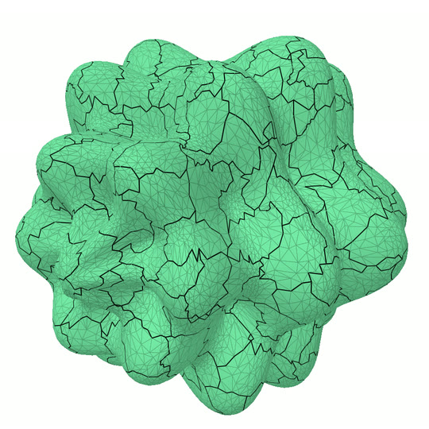<figcaption>L2 · 33K</figcaption></figure>
    <figure>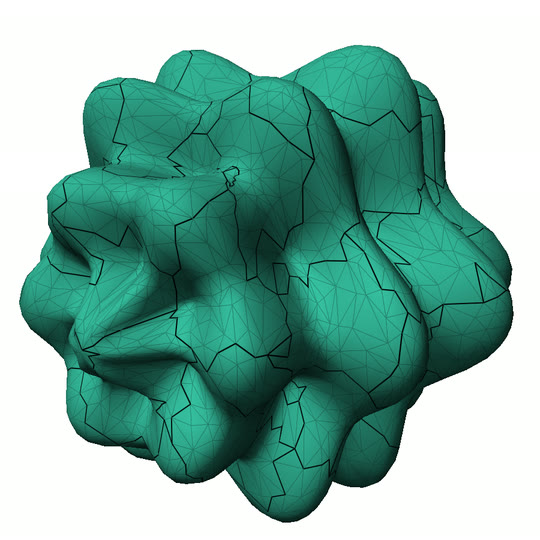<figcaption>L4 · 8.3K</figcaption></figure>
    <figure>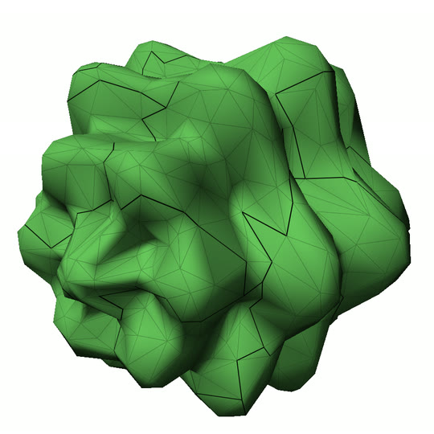<figcaption>L6 · 2.1K</figcaption></figure>
  </div>
  <figcaption>The bundled <code>metasphere.ply</code> at four levels of meshoptimizer's cluster DAG (<code>--lod-level N</code>). Black lines are
  meshlet borders, thin lines are triangles, and the color encodes the level: a CIELAB palette whose lightness falls in equal steps from
  pale yellow (full detail) to red (coarsest), with the hue turning in between, so every level stays light enough for the black lines to
  read on it. Every level is built from the same clustering steps described below.</figcaption>
</figure>

<div class="toc" markdown="1">
**Contents**

1. [What a meshlet is](#what-a-meshlet-is)
2. [Pipeline overview](#pipeline-overview)
3. [Preparing the mesh](#preparing-the-mesh)
4. [Clustering one level](#clustering-one-level)
5. [Per-meshlet data](#per-meshlet-data)
6. [Cluster LOD: building the DAG](#cluster-lod-building-the-dag)
7. [meshlet-optimizer: a remeshed hierarchy](#meshlet-optimizer-a-remeshed-hierarchy)
8. [Picking a cut at runtime](#picking-a-cut-at-runtime)
9. [Comparing the two hierarchies](#comparing-the-two-hierarchies)
10. [Parameters](#parameters)
</div>

## What a meshlet is

Mesh shaders replace the fixed vertex fetch and primitive assembly stages with compute-like workgroups. Each
workgroup emits a small, self-contained piece of geometry: up to a few hundred vertices and triangles. A
**meshlet** is one such piece, prepared offline. The viewer allows up to 256 vertices and 256 triangles per
meshlet (the defaults are 64 and 124).

A meshlet is stored as two arrays plus a small header (`meshopt_Meshlet`):

<figure>
  
  <figcaption>Each meshlet references a run of <code>vertices[]</code> (32-bit indices into the mesh's vertex buffer) and a run of
  <code>triangles[]</code> (three 8-bit indices into that run). The 8-bit local indices are why a meshlet can hold at most 256
  vertices.</figcaption>
</figure>

The mesh shader loads the meshlet's vertices once into its output arrays, then writes its triangles using the
local indices, so a vertex shared by several triangles in the meshlet is transformed only once. A good clustering
therefore wants:

- **Few vertices per triangle.** A compact, roughly round patch shares most of its vertices between triangles; a
  long strip doesn't. On a regular mesh, a disk of \(V\) vertices holds about \(2V\) triangles minus its boundary length, so 64
  vertices hold roughly 100 triangles. That's why the metasphere's meshlets average 64 vertices and 97 triangles: they hit the vertex limit first.
- **Full meshlets.** Every meshlet costs a workgroup, so half-empty ones waste GPU time.
- **Spatially tight meshlets.** Bounding spheres and normal cones are used to cull whole meshlets, which only works
  when each one is small and roughly flat.

## Pipeline overview

<figure>
  
  <figcaption>The build runs once per model on a background thread (<code>loadModel</code> and <code>buildMeshlets</code> in
  <code>src/model.cpp</code>). The green loop is meshoptimizer's <code>clodBuild</code> (<code>external/meshoptimizer/demo/clusterlod.h</code>);
  with <code>--no-lod</code> it is skipped and a single level is built with one of the four builders. The other LOD source,
  meshlet-optimizer, replaces the whole build (see <a href="#meshlet-optimizer-a-remeshed-hierarchy">below</a>).</figcaption>
</figure>

## Preparing the mesh

`loadModel` reads a PLY or OBJ file into a flat vertex buffer (position + normal) and a triangle index buffer, then:

1. **Welds** identical vertices (`meshopt_generateVertexRemap` for OBJ, whose faces index positions and normals
   separately). Clustering works on shared vertices, so an unwelded mesh would look like a soup of disconnected triangles.
2. **Computes normals** when the file has none, by summing area-weighted face normals at each vertex.
3. **Reorders the triangles for vertex-cache locality** (`meshopt_optimizeVertexCache`, skip with `--no-vertex-cache`).
   Triangles that share vertices end up close together in the index buffer. The scan builder depends on this directly,
   and it makes the greedy builder's fallback search cheaper.

## Clustering one level

All builders share one primitive, `appendMeshlet`: add a triangle to the current meshlet, assigning local indices to any
of its vertices the meshlet hasn't seen yet. If that would exceed the vertex or triangle limit, the current meshlet is
written out first and a new one started. A per-vertex `used[]` array maps global vertex → local index (or −1) so this
check is O(1). The builders differ only in **which triangle comes next**.

<figure>
  
  <figcaption>The three strategies on a 352-triangle test grid with a limit of 16 vertices and 18 triangles. These panels come from
  small Python ports of the meshoptimizer algorithms (<code>docs/_figures/gen_figures.py</code>). The grid's index order is row by row,
  which is the worst case for scan. On real meshes after vertex-cache ordering, scan does much better, but its meshlets still have
  ragged borders.</figcaption>
</figure>

### Scan (`-a scan`)

`meshopt_buildMeshletsScan` walks the index buffer in order and cuts a meshlet whenever the next triangle doesn't fit.
It's linear-time and needs no positions, but the result is only as good as the input order: it never looks at
neighbors, so meshlets follow whatever path the index buffer happens to take.

### Greedy growth (`-a greedy`, `-a flex`, and the LOD builder)

`meshopt_buildMeshlets` is `meshopt_buildMeshletsFlex` with `min_triangles = max_triangles` and no splitting. It grows each
meshlet one triangle at a time from a seed, always preferring triangles that touch the meshlet already. This is the
builder `clodBuild` uses for every level of the LOD hierarchy (unless `--lod-spatial`).

**Setup.** The builder computes:

- **Triangle adjacency**: for each vertex, the list of triangles that use it.
- **Live counts**: for each vertex, how many of its triangles haven't been placed yet. Whenever a triangle is emitted it's
  removed from its vertices' adjacency lists, so these counts drop as the mesh is used up.
- **Per-triangle centroid and unit normal.**
- **Expected meshlet radius**, assuming a meshlet is a square patch of `max_triangles` average-sized triangles:

$$ r_{\text{exp}} = \tfrac{1}{2}\sqrt{\bar{A}\cdot T_{\max}} $$

where \\(\bar{A}\\) is the average triangle area (half the cross-product length).

- **A kd-tree over the triangle centroids**, used when growth gets stuck.

The first seed is the triangle whose centroid is closest to the minimum corner of the mesh's bounding box. Starting at a
corner makes meshlets sweep across the surface instead of leaving holes in the middle.

**Choosing the next triangle.** For every vertex already in the meshlet, every live triangle around it is a candidate.
Each candidate first gets a **topological priority** from the number of new vertices it would add (`extra`) and the live
counts of its vertices:

| priority | condition | why |
|---|---|---|
| 0 | `extra == 0`: all three vertices are already in the meshlet | a free triangle; it costs no vertex slot |
| 1 | one of its vertices has a live count of 1 | otherwise this triangle would be left dangling, and would cost a whole new vertex set later |
| 1 + extra | two of its vertices have a live count of 2 | taking it leaves a neighbor dangling, which the next step can pick up as priority 1 |
| 2 + extra | anything else | 3 or 4, by vertex cost |

Lower priority always wins. Ties are broken by a **geometric score** (lower is better) combining distance to the
meshlet's running centroid \\(c\\) and agreement with its average normal \\(n\\):

$$ \text{score} = \left(1 + \frac{\lVert p_t - c\rVert}{r_{\text{exp}}}\,(1 - w)\right)\cdot \max\!\left(10^{-3},\; 1 - w\,(n_t\cdot n)\right) $$

\\(w\\) is the **cone weight** (`--cone-weight`, default 0.25). At \\(w = 0\\) the score is pure distance and meshlets come out round;
as \\(w\\) grows, triangles that face the same way as the meshlet are preferred. That narrows each meshlet's normal cone, so more
meshlets can be backface culled as a whole, at the cost of less compact shapes. (`clodBuild` passes \\(w = 0\\): after simplification
cone culling matters less than compactness.)

<figure>
  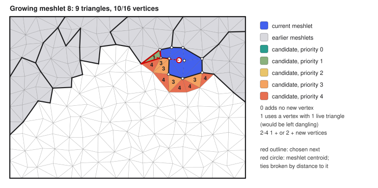
  <figcaption>One step of greedy growth. The current meshlet (blue) has 9 triangles and 10 vertices. Each candidate around it is labeled
  with its priority. The one outlined in red is priority 1: it uses a vertex whose only remaining triangle it is. Ties within a priority
  go to the candidate closest to the meshlet's centroid (red circle).</figcaption>
</figure>

**When the meshlet is full.** If the best candidate would exceed `max_vertices` or `max_triangles`, the meshlet is closed and a
new one needs a seed. Instead of continuing from the rejected candidate, the builder keeps a list of up to 256 **seed
triangles**. For each vertex of the meshlet that just closed, the adjacent triangle with the smallest total live count is
added (up to 4 per meshlet). The next seed is the one with the lowest live count, closest to the starting corner. Low live
counts mean triangles at the edge of the unprocessed region, so the next meshlet starts right where the last one left off
and the front of finished meshlets advances as one piece.

**When no neighbor is left.** If no triangle touches the meshlet (an island, or a region already surrounded by finished meshlets),
the kd-tree supplies the nearest unplaced triangle to the meshlet's centroid. With `--split-factor F > 0` (flex only), if that triangle
is farther than \\(F \cdot r_{\text{exp}}\\) away and the meshlet already has `--min-triangles`, the meshlet is closed early rather than
stretched across a gap. This is how flex trades a few smaller meshlets for tighter bounds.

The whole loop is \\(O(T \cdot k)\\) for \\(T\\) triangles and average valence \\(k\\), since each step only scans the adjacency of the
current meshlet's vertices.

### Spatial / SAH (`-a spatial`, `--lod-spatial`)

`meshopt_buildMeshletsSpatial` ignores connectivity and partitions the triangles top-down, like building a BVH for ray tracing:

1. Compute each triangle's bounding box and centroid, and **radix-sort** the triangle list three times, once by centroid along each of x, y and z.
2. **Split recursively.** If the current range fits in one meshlet (≤ `max_triangles`, ≤ `max_vertices` unique vertices), it becomes a leaf.
   Otherwise, for each axis, sweep the sorted order and evaluate every cut position \\(i\\) with the **surface area heuristic**:

   $$ \text{cost}(i) = A(\text{left}_i)\cdot|\text{left}_i| + A(\text{right}_i)\cdot|\text{right}_i| \;+\; f\cdot\big(\text{waste}_L\,A_L + \text{waste}_R\,A_R\big) $$

   \\(A\\) is the surface area of the side's bounding box, computed for all cuts in two linear passes (prefix from the left, suffix from the right).
   The second term, weighted by `--fill-weight` \\(f\\), charges for slots a side would leave empty once rounded up to whole meshlets, so
   the splitter favors cuts that produce full meshlets.
3. **Only cuts that can be tiled are allowed.** A side with \\(n\\) triangles is admissible only if \\(n\\) can be written as a sum of sizes in
   `[min_triangles, max_triangles]`. Otherwise the recursion could end up with a leftover piece too small to be a valid meshlet.
4. Take the cheapest cut over all three axes, partition the other two sorted orders stably, and recurse on both halves.

<figure>
  
  <figcaption>The first SAH split of the test grid. The cost is evaluated at every admissible cut along both axes. The cheapest is the vertical
  cut near the middle of the x sweep (circled), since it halves the widest dimension.</figcaption>
</figure>

The result is tiled, very full meshlets with tight boxes, which is good for ray tracing and culling. But it doesn't optimize for shared vertices, so
vertex counts per meshlet are higher than with greedy growth.

<figure>
  <div class="grid grid-3">
    <figure><figcaption>scan · 1001 meshlets</figcaption></figure>
    <figure>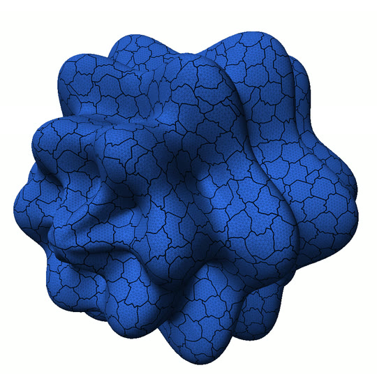<figcaption>greedy · 869</figcaption></figure>
    <figure>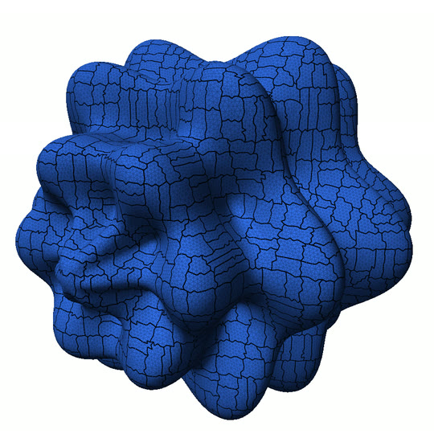<figcaption>spatial · 1335</figcaption></figure>
  </div>
  <figcaption>The three builders on the metasphere with <code>--no-lod</code> and default limits (64 vertices / 124 triangles; spatial with 32 minimum
  triangles). Counts are the meshlets visible from this view after culling.</figcaption>
</figure>

### Optimizing each meshlet

Without LOD, every meshlet is then passed to `meshopt_optimizeMeshlet`, which reorders its triangles and local vertices for locality
inside the meshlet. `clodBuild` does the same internally (`optimize_clusters`). Turn it off with `--no-optimize-meshlets`.

## Per-meshlet data

After clustering, `buildMeshlets` computes three more things for every meshlet, in parallel:

- **Bounding sphere and normal cone** (`meshopt_computeMeshletBounds`). The cone axis is the average triangle normal, and the cutoff
  is derived from the widest angle between that axis and any triangle normal. The task shader rejects a meshlet whose every triangle
  faces away from the camera at \\(e\\):

  $$ (c - e)\cdot a \;\ge\; \text{cutoff}\cdot\lVert c - e\rVert + r $$

  using the sphere \\((c, r)\\) and cone axis \\(a\\). The \\(+r\\) term makes the test valid anywhere on the meshlet, not just at its center.
- **Perimeter edge masks.** For each triangle, a 3-bit mask of which edges lie on the meshlet's border: an edge used by exactly one
  triangle of the meshlet. The fragment shader draws the black meshlet outlines from these bits.
- **Statistics**: fill rates, average cone angle, and the fraction of meshlets with a usable cone, shown in the sidebar.

## Cluster LOD: building the DAG

With LOD on (the default), the viewer calls `clodBuild`, meshoptimizer's implementation of the Nanite-style cluster hierarchy.
The goal is a set of clusters at many levels of detail, such that the GPU can draw any **mix** of levels, fine near the camera
and coarse far away, without cracks between neighbors at different levels.

### Why simplify groups, not clusters

Simplifying each cluster on its own would mean locking its whole border so that it still matches its neighbors. After a few
levels the borders would hold most of the triangles and simplification would stall. The fix (from Karis' *Nanite* talk) is to
alternate which edges are locked:

1. **Group** neighboring clusters, about 16 at a time.
2. **Lock** only the edges between groups, then **simplify** each group as one mesh to about half its triangles. Edges *inside* the group, which
   were cluster borders before, are now free to collapse.
3. **Re-clusterize** the simplified group into new clusters (roughly half as many).
4. Repeat on the new clusters. The next level's groups are different, so the edges locked this time are interior next time.

Because each group's simplified clusters share the same locked border as the group's original clusters, the GPU can swap a whole group
between its fine and coarse versions without a crack.

### Partitioning clusters into groups

`meshopt_partitionClusters` is a bottom-up (agglomerative) clustering of clusters, based on Kurita's heap-based method:

1. Build a **cluster adjacency graph**. Two clusters are adjacent if they share a vertex. The edge weight is the number of shared vertices.
   Vertices are first remapped by position (`meshopt_generatePositionRemap`) so clusters separated by a normal or UV seam still count as connected.
2. Start with one group per cluster, in a min-heap keyed on vertex count.
3. Pop the **smallest** group. If it has reached the target size, emit it. Otherwise merge it with the adjacent group that maximizes

   $$ \text{score} = s \cdot\left(\frac{1}{\sqrt{v_a}} + \frac{1}{\sqrt{v_b}}\right)\cdot\big(1 + 0.4\,\beta\big) $$

   where \\(s\\) is the number of shared vertices, \\(v_a, v_b\\) are the groups' vertex counts, and \\(\beta \in [0, 1]\\) is a bounding-sphere
   overlap term that favors spatially close groups. Dividing by \\(\sqrt{v}\\) normalizes by the expected border length of each group, so
   the merge that hides the most border relative to size wins. Merges that would exceed 4/3 of the target size are skipped.
4. Push the merged group back and repeat.
5. Finally, small leftover groups are merged by spatial proximity alone (a kd-split over group centers), which catches disconnected pieces.

Popping the smallest group first keeps group sizes even. Maximizing shared vertices keeps each group compact, with a short border, which is exactly the set of edges
that will be locked.

<figure>
  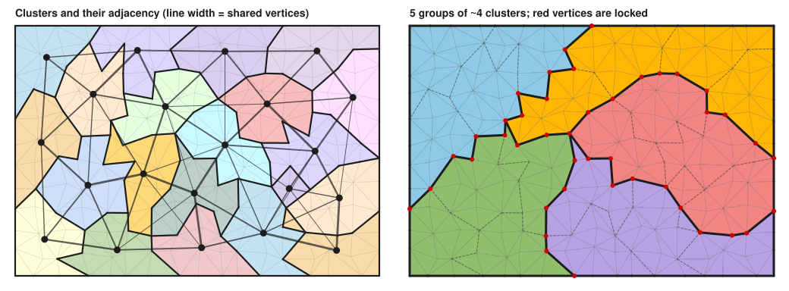
  <figcaption>Left: greedy clusters of the test grid and their adjacency graph (thicker = more shared vertices). Right: the result of
  partitioning with a target of 4 clusters per group (the viewer uses 16, <code>--lod-partition</code>). Dashed lines are the old cluster
  borders, now free to simplify. The red vertices on group borders are locked.</figcaption>
</figure>

### Locking, simplifying and error tracking

For each level, `clodBuild`:

- **Locks group borders.** Every vertex used by more than one group gets a lock bit, and so does every vertex at the same
  position, so seams stay consistent.
- **Simplifies each group** with `meshopt_simplifyWithAttributes` to `--lod-ratio` × its triangle count (default 0.5). It runs with:
  - normals as attributes (weight 0.5 each), so shading creases are preserved;
  - *permissive* mode, which allows collapses across attribute seams where that does little visible damage;
  - *sparse* mode, which only touches the group's vertices;
  - an *absolute* error result in model units.

  If the target isn't reached, it falls back to `meshopt_simplifySloppy` (vertex clustering, ignores topology) and multiplies the reported error by 2 to account for the
  rougher result.
- **Marks stuck groups terminal.** If simplification keeps more than 85% of the triangles, the group is marked terminal (`error = FLT_MAX`)
  and not simplified further.
- **Keeps errors monotonic.** A group's bounds are the merged spheres of its clusters' bounds, not the tight bounds of the simplified mesh.
  Its error is

  $$ e_{\text{group}} = \max\big(\max_{c \in \text{group}} e_c,\; e_{\text{simplify}}\big) $$

  so a coarser level never reports a *smaller* error than the level below it, and its bounding sphere always contains its children's.
  Monotonicity is what lets the runtime make each decision locally (next section).
- **Re-clusterizes** the simplified triangles with the same greedy builder (`--min-triangles` / `--max-triangles`, split factor 2) and gives the new
  clusters the group's bounds and error.

The loop stops when one cluster is left, or when every group is terminal.

Each group is reported to the viewer through a callback. For every cluster the viewer stores two error spheres (`MeshletLod` in `src/model.h`):

- **self**: the error of the group that *produced* this cluster (0 for original geometry), i.e. how wrong this cluster is.
- **coarse**: the error of the group this cluster *belongs to*, i.e. how wrong its replacement would be.

<figure>
  
  <figcaption>The cluster DAG. Dashed boxes are groups; each group of four is simplified into two clusters on the level above. Group errors are
  projected to pixels for one camera position. Red groups are above the 1 px threshold, green ones are under it. The filled clusters form a valid
  cut: they cover the surface exactly once, mixing L0, L1 and L2.</figcaption>
</figure>

On the metasphere (132K triangles) this produces 12 levels and 2933 clusters in total: 1364 at level 0, with the triangle
count halving at every level (132K, 66K, 33K, … 128, 64).

**Complexity.** One level does a partition, a simplification and a clusterization over its \(n\) triangles: about
\(O(n \log n)\) (heaps in the partitioner and simplifier, near-linear clustering). Every level halves the triangle count, so the
levels form a geometric series and the whole DAG costs \(O(T \log T)\) for \(T\) input triangles, dominated by the first level.
There are about \(\log_2(T / T_{\max})\) levels.

## meshlet-optimizer: a remeshed hierarchy

`--lod-source meshlet-optimizer` (or the sidebar's LOD source) builds the hierarchy with
[meshlet-optimizer](https://github.com/rgb2hsv/meshlet-optimizer), a submodule in `external/meshlet-optimizer`. The viewer writes the
mesh to a temporary PLY, runs the tool and loads the `.mlod` it writes (`src/meshlet_optimizer.cpp`). Instead of simplifying groups of
clusters, it partitions the surface into **regions**, merges them level by level, and **remeshes** every merged region from scratch:

1. **Base charts.** Blue-noise seeds on the surface are relaxed to a restricted centroidal Voronoi tessellation (CVT): Lloyd iterations,
   then L-BFGS on the CVT energy. The cells are regularized into compact, disk-shaped charts of at most `--chart-triangles` (256) triangles
   and their borders straightened along mesh edges. These charts are level 0: the input mesh, cut into regions.
2. **Clustering.** Each level merges the regions of the one below into cliques of up to `--max-clique` (4) neighbors, keeping each new
   region a disk (holes filled, stray members shed).
3. **Remeshing.** All merged regions are flattened together (planar start, then one LSCM solve, each region padded with a ring of its
   neighbors). In 2D, each region keeps `--interior-fraction` (35%) of its interior vertices as fresh blue-noise samples, relaxed by a
   restricted CVT and triangulated with constrained Delaunay inside the fixed border. The new points are lifted back to 3D and snapped
   onto the input surface. Regions over 256 triangles are split in two.
4. **Nested borders.** Each level's region borders are coarsened by edge collapses, and the finer levels' border vertices are moved onto the
   new, coarser border edges. Every border of every level therefore lies on the borders of all levels below it, so any two levels can sit side
   by side without a crack. A final pass fixes flat triangles that snapping creates and slides border vertices to even out border edges
   (L-BFGS-B on a CVT energy along the borders).
5. **UVs.** Input texture coordinates are carried through every level (regions never cross a UV seam). The metasphere has none, so the tool
   generates one atlas per level: the level's regions are flattened and bin-packed into the unit square at one common scale.
6. **Export.** Every region of every level becomes one meshlet. A *group* is the set of level-\(k\) regions that merge into one level-\(k+1\)
   region, and that region is its replacement. A region's error is the larger of its children's errors and the two-way vertex distance
   between its remeshed surface and its children's, so errors grow monotonically up the DAG, as the runtime needs. The selection BVH is
   `clodBuildHierarchy`'s, as for meshoptimizer.

<figure>
  <div class="grid grid-4">
    <figure>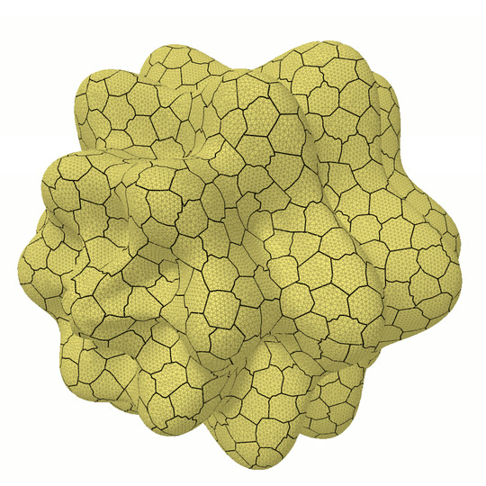<figcaption>L0 · 132K triangles</figcaption></figure>
    <figure>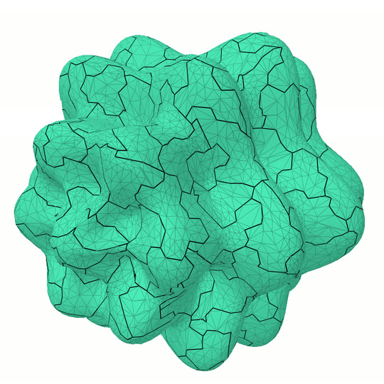<figcaption>L2 · 19.7K</figcaption></figure>
    <figure>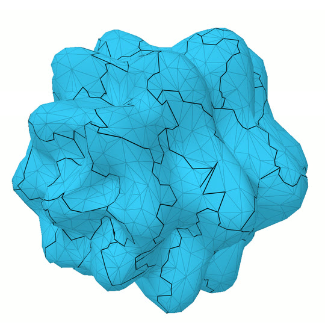<figcaption>L4 · 4.7K</figcaption></figure>
    <figure>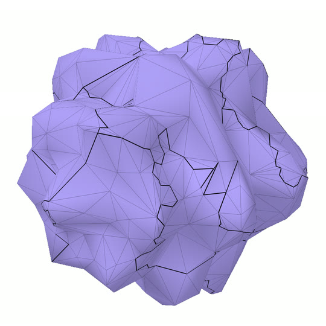<figcaption>L6 · 1.7K</figcaption></figure>
  </div>
  <figcaption>The same levels as the figure at the top, built by meshlet-optimizer. Level 0 is the input triangles, cut into CVT charts:
  round regions of similar size. From level 1 on the triangles are new: evenly spaced inside each region, with region borders that
  stay on the borders of every finer level. Colors use the same palette; the levels shrink faster than meshoptimizer's (10 levels instead of 12).</figcaption>
</figure>

<figure>
  <video src="assets/video/mopt-auto-lod.mp4" poster="assets/video/mopt-auto-lod.jpg" width="1280" height="824"
         autoplay muted loop playsinline controls preload="metadata"
         aria-label="The viewer orbiting and zooming around a meshlet-optimizer metasphere with automatic LOD selection"></video>
  <figcaption>A meshlet-optimizer <code>.mlod</code> of the metasphere in the viewer, with automatic selection at about a 5 px error threshold,
  <code>--auto-rotate</code> and <code>--auto-zoom</code>. As the camera closes in, finer levels (lighter) replace coarser ones (darker), and
  meshlets of different levels meet along shared borders without cracks. The sidebar's level table shows how many triangles each level draws.</figcaption>
</figure>

<figure>
  <div class="grid grid-2">
    <figure>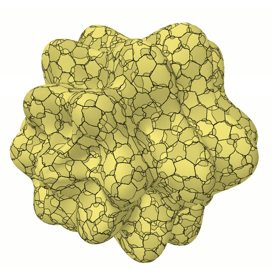<figcaption>L0 atlas</figcaption></figure>
    <figure>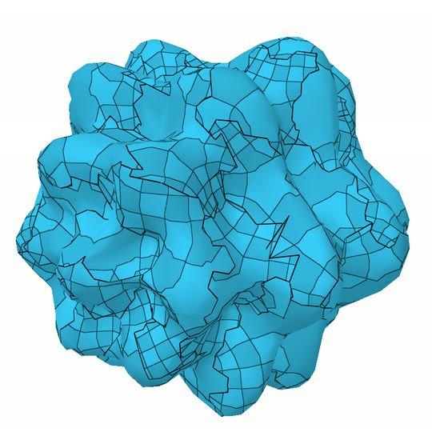<figcaption>L4 atlas</figcaption></figure>
  </div>
  <figcaption>The generated per-level UV atlases, shown with the viewer's UV grid (<code>--uv-grid</code>) instead of the triangle wireframe.
  Each region is one chart: grid lines run straight and evenly spaced across it (low distortion) and break at region borders, where the charts
  are cut apart. All charts of a level share one scale, so cells are the same size everywhere.</figcaption>
</figure>

On the metasphere this produces 10 levels and 2372 meshlets: 1140 at level 0, then 735, 257, 105, … 4. Level 1 keeps 36% of the
triangles and later levels 40–55%, so the hierarchy is shallower than meshoptimizer's.

**Complexity.** The base CVT runs a fixed number of Lloyd and L-BFGS iterations, each assigning all \(T\) triangles to their nearest seeds
through a spatial tree: \(O(I \cdot T \log T)\). Each level then works on its own \(n\) vertices: one sparse LSCM solve over all regions
(a sparse factorization, roughly \(O(n^{1.5})\) for surface meshes), blue-noise sampling and per-region 2D CVT (\(O(n)\) per iteration),
constrained Delaunay (\(O(n \log n)\)) and projection onto the input (\(O(n \log T)\)). Levels shrink geometrically, so they add a constant
factor over level 1. The border relaxation optimizes the border vertices of all levels jointly, \(O(I_b \cdot B)\) for \(B\) border vertices
over \(I_b\) iterations. The optional crack check (`--check-cracks`) compares every pair of levels, quadratic in the level count. Overall the
tool does asymptotically more work than `clodBuild`, chiefly the iterative CVT and the global LSCM solves.

## Picking a cut at runtime

A cluster's object-space error \\(e\\) is projected to pixels using the closest point of its error sphere \\((c, r)\\) to the camera:

$$ \text{px}(e, c, r) = \frac{e}{\max(\lVert c - \text{eye}\rVert - r,\; z_{\text{near}})}\cdot \frac{\cot(\text{fov}_y/2)}{2}\cdot H $$

where \\(H\\) is the viewport height. A cluster is drawn exactly when

$$ \text{px}(\text{coarse}) > \tau \quad\text{and}\quad \text{px}(\text{self}) \le \tau $$

for the threshold \\(\tau\\) (`--lod-error`, default 1 px). In words: the cluster's replacement would be visibly wrong, but the cluster itself isn't.
Since errors and spheres grow monotonically up the DAG, both quantities change in step along any path from a leaf to the root, so exactly one
cluster on each path passes. That's why the selected clusters tile the surface with no gaps or overlaps, without any communication between clusters.
And since all clusters of a group share the same *coarse* sphere and error, a group always switches as a unit, along its locked border.

Testing all clusters every frame would be wasteful, since most clusters of a large mesh are far too fine or too coarse. So the build also runs
`clodBuildHierarchy`, which builds an 8-wide **BVH over the groups**, one tree per DAG level. Each node stores the merged sphere and maximum error of its subtree.
On the GPU, `lod_traverse.comp` walks these trees breadth-first, one compute dispatch per tree depth:

- A node outside the frustum is skipped.
- A node whose projected error is ≤ \\(\tau\\) is skipped, because every group below it is fine enough to be replaced by its parent.
  Internal nodes use a small safety margin against float rounding in the merged bounds.
- A leaf (one group) emits the group's clusters whose own `self` error is ≤ \\(\tau\\) as **candidates**.

The task shader (`meshlet.task`) then does frustum and normal-cone culling on each candidate and launches one mesh-shader workgroup per survivor.
Selection thus visits only the nodes along the cut, \(O(\text{cut} \cdot \log C)\), instead of testing all \(C\) clusters. Both builders'
hierarchies are drawn this way.

<figure>
  <div class="grid grid-2">
    <figure><figcaption>meshoptimizer · 17.6K triangles, 210 meshlets</figcaption></figure>
    <figure>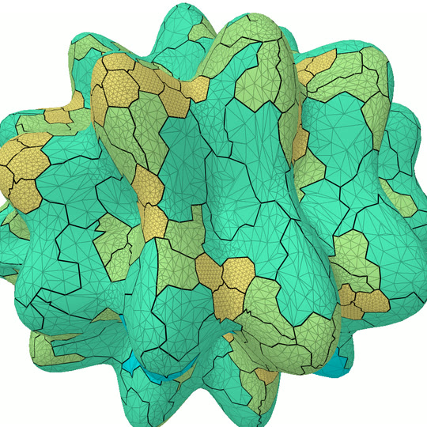<figcaption>meshlet-optimizer · 27.7K, 339</figcaption></figure>
  </div>
  <figcaption>Automatic selection with <code>--lod-error 4</code> from a closer view, same camera for both. Regions that are flatter or farther away use
  coarser clusters. At the same threshold meshlet-optimizer needs 58% more triangles (counts are after culling), since each of its levels
  deviates more from the input. Borders between levels have no cracks: meshoptimizer's follow locked group borders, meshlet-optimizer's
  follow its nested region borders.</figcaption>
</figure>

## Comparing the two hierarchies

Both builders ran on the metasphere with default settings, and `docs/_figures/mlod_stats.py` measured the `.mlod` files they wrote. Each
row is one DAG level as `--lod-level k` draws it. The builders' limits differ: meshoptimizer caps meshlets at 64 vertices and 124 triangles,
meshlet-optimizer at 256 of each (its largest meshlet has 109 vertices and 166 triangles), so per-meshlet sizes are not like for like.

Columns: **vrefs/tri** is vertex references per triangle (each meshlet transforms its vertices once, so lower is less vertex work);
**q** is the triangle radius ratio (1 equilateral, 0 degenerate) and **slivers** the share with \(q < 0.3\); **IQ** is the median
isoperimetric quotient \(4\pi A / P^2\) of the meshlets (1 for a disk); **cullable** is the share of meshlets whose normal cone allows
backface culling; **deviation** is the two-way vertex-sampled distance between the level and the input surface, in input edge lengths
(the metasphere's average edge is 0.88 units).

**meshoptimizer (clodBuild)**

| level | meshlets | triangles | tris / meshlet | verts / meshlet | vrefs/tri | q (median) | slivers | IQ | cullable | deviation mean | deviation max |
|---:|---:|---:|---:|---:|---:|---:|---:|---:|---:|---:|---:|
| 0 | 1364 | 132524 | 97.2 | 63.7 | 0.655 | 0.979 | 0% | 0.654 | 100% | – | – |
| 1 | 774 | 66206 | 85.5 | 60 | 0.702 | 0.838 | 1.57% | 0.504 | 99.9% | 0.00357 | 0.0927 |
| 2 | 396 | 33068 | 83.5 | 59.9 | 0.717 | 0.749 | 3.11% | 0.442 | 99.2% | 0.0103 | 0.144 |
| 3 | 199 | 16520 | 83 | 59.6 | 0.718 | 0.727 | 4.11% | 0.422 | 98% | 0.0223 | 0.314 |
| 4 | 101 | 8252 | 81.7 | 58.8 | 0.72 | 0.725 | 4.64% | 0.397 | 96% | 0.0507 | 0.624 |
| 5 | 50 | 4120 | 82.4 | 58.9 | 0.714 | 0.713 | 4.76% | 0.427 | 94% | 0.13 | 1.09 |
| 6 | 25 | 2058 | 82.3 | 58.3 | 0.708 | 0.711 | 4.96% | 0.448 | 48% | 0.326 | 2.29 |
| 7 | 12 | 1026 | 85.5 | 58.4 | 0.683 | 0.729 | 3.22% | 0.547 | 16.7% | 0.727 | 4.22 |
| 8 | 6 | 512 | 85.3 | 56.3 | 0.66 | 0.717 | 2.54% | 0.527 | 16.7% | 1.5 | 8.46 |
| 9 | 3 | 256 | 85.3 | 52.3 | 0.613 | 0.723 | 4.69% | 0.82 | 0% | 2.97 | 13 |
| 10 | 2 | 128 | 64 | 35.5 | 0.555 | 0.607 | 10.2% | – | 50% | 4.53 | 19.9 |
| 11 | 1 | 64 | 64 | 34 | 0.531 | 0.613 | 3.12% | – | 0% | 6.05 | 20.5 |

**meshlet-optimizer**

| level | meshlets | triangles | tris / meshlet | verts / meshlet | vrefs/tri | q (median) | slivers | IQ | cullable | deviation mean | deviation max |
|---:|---:|---:|---:|---:|---:|---:|---:|---:|---:|---:|---:|
| 0 | 1140 | 132526 | 116 | 73.8 | 0.635 | 0.959 | 0.218% | 0.783 | 100% | – | – |
| 1 | 735 | 48290 | 65.7 | 45.7 | 0.696 | 0.837 | 3.56% | 0.565 | 99.3% | 0.0229 | 0.762 |
| 2 | 257 | 19682 | 76.6 | 53.2 | 0.695 | 0.763 | 6.12% | 0.475 | 93.8% | 0.0423 | 0.787 |
| 3 | 105 | 8934 | 85.1 | 63.3 | 0.743 | 0.727 | 7.03% | 0.366 | 86.7% | 0.0773 | 1.23 |
| 4 | 59 | 4710 | 79.8 | 65.5 | 0.821 | 0.687 | 8.47% | 0.347 | 69.5% | 0.165 | 3.84 |
| 5 | 33 | 2692 | 81.6 | 69.3 | 0.85 | 0.659 | 10.2% | 0.342 | 54.5% | 0.382 | 4.2 |
| 6 | 19 | 1690 | 88.9 | 78.5 | 0.883 | 0.631 | 12.5% | 0.273 | 10.5% | 0.781 | 7.99 |
| 7 | 12 | 1074 | 89.5 | 80.2 | 0.897 | 0.627 | 12.8% | 0.304 | 0% | 1.63 | 15.3 |
| 8 | 8 | 628 | 78.5 | 69.1 | 0.881 | 0.642 | 12.4% | 0.279 | 0% | 2.42 | 16.1 |
| 9 | 4 | 276 | 69 | 53 | 0.768 | 0.698 | 6.88% | 0.495 | 0% | 3.18 | 15.3 |

What the numbers show:

- **Level 0.** Both levels are the input triangles, so they differ only in how they are cut. meshlet-optimizer's CVT charts are rounder
  (median IQ 0.78 against 0.65) and larger, with slightly fewer vertex references per triangle (0.635 against 0.655).
- **Accuracy per triangle.** At matching triangle counts, meshoptimizer's levels stay closer to the input. Its error-driven simplification
  keeps vertices where curvature needs them; meshlet-optimizer resamples each region at an even density regardless of curvature. Around
  9K triangles the mean deviation is 0.05 edges (meshoptimizer L4, 8.3K) against 0.08 (meshlet-optimizer L3, 8.9K); around 1K it is 0.73 against 1.6.
  meshlet-optimizer also has larger worst cases from its first level on (0.8 edges at L1 against 0.09), where region borders and snapping
  meet curved surface.
- **Triangle shape.** meshlet-optimizer's remeshed interiors are isotropic, but its median \(q\) is about the same as meshoptimizer's at the
  same level (0.76 against 0.75 at L2), and it has more slivers at every level past 0 (6% against 3% at L2, 12% against 5% at L6). They come
  most likely from the region borders, which are coarsened by collapses and then constrain the triangulation on both sides.
- **Meshlet shape and culling.** meshlet-optimizer's meshlets are whole regions, merged four at a time: compact at first, but less round
  than meshoptimizer's re-clustered meshlets from L3 on (IQ 0.37 against 0.42), with more vertex references per triangle (0.82 against 0.72
  at L4) and wider normal cones (cullable 70% against 96% at L4).
- **Structure.** meshlet-optimizer's levels are strictly nested: every coarse region is the union of its children and its border is made of
  their borders, which also gives each level a low-distortion UV atlas. meshoptimizer's groups are re-partitioned at every level, so
  borders move, and it produces no parameterization.

In short: for drawing the surface with the fewest triangles at a given error, meshoptimizer's DAG is the better hierarchy on this model.
meshlet-optimizer trades some accuracy and culling for a nested region structure with per-level UV charts and evenly sized, round level-0
meshlets.

## Parameters

| flag | default | effect |
|---|---|---|
| `--max-vertices N` | 64 | vertex limit per meshlet (≤ 256, from the 8-bit local indices) |
| `--max-triangles N` | 124 | triangle limit per meshlet |
| `--min-triangles N` | 32 | smallest meshlet flex and spatial may close early (also used by LOD) |
| `-a, --algorithm` | greedy | single-level builder with `--no-lod`: `greedy`, `flex`, `spatial`, `scan` |
| `--cone-weight W` | 0.25 | greedy/flex: trade compactness for narrower normal cones |
| `--split-factor F` | 2 | flex and LOD: close a meshlet instead of jumping farther than F × expected radius |
| `--fill-weight W` | 0.5 | spatial: prefer full meshlets over SAH quality |
| `--no-lod` | off | build one meshlet level instead of the DAG |
| `--lod-spatial` | off | LOD clusters with the SAH builder instead of flex |
| `--lod-ratio R` | 0.5 | triangle ratio each simplification step aims for |
| `--lod-partition N` | 16 | target clusters per group |
| `--lod-error PX` | 1 | runtime projected-error threshold |
| `--lod-level N` | auto | draw a fixed DAG level instead |
| `--lod-source S` | meshoptimizer | `meshoptimizer` or `meshlet-optimizer`; a `.mlod` input is drawn as saved |
| `--mopt-chart-triangles N` | 256 | meshlet-optimizer: largest base chart (level-0 meshlet), in triangles |
| `--mopt-stop-at-regions N` | 2 | meshlet-optimizer: stop once the top level has at most N regions |
| `--mopt-max-depth N` | 12 | meshlet-optimizer: most levels above the base |
| `--mopt-interior-fraction F` | 0.35 | meshlet-optimizer: interior vertices kept per region and level |
| `--uv-grid`, `--uv-grid-cells N` | off, 16 | draw a UV grid instead of the triangle wireframe (models with UVs) |

### Reproducing the figures

The diagrams in this page are generated by

```bash
python docs/_figures/gen_figures.py
```

the renders by the viewer itself (which also saves both hierarchies when `MLOD_DIR` is set), and the comparison tables by
the statistics script:

```bash
MLOD_DIR=out bash docs/_figures/render_images.sh
python docs/_figures/mlod_stats.py out/meshoptimizer.mlod out/meshlet-optimizer.mlod
```

### Further reading

- Arseny Kapoulkine, [meshoptimizer](https://github.com/zeux/meshoptimizer): `src/clusterizer.cpp`, `src/partition.cpp`, `demo/clusterlod.h`.
- [meshlet-optimizer](https://github.com/rgb2hsv/meshlet-optimizer): `src/hierarchy/MeshletBuilder.hpp` lists every stage of its build.
- Qiang Du, Max Gunzburger, Lili Ju, *Constrained Centroidal Voronoi Tessellations for Surfaces*, SIAM J. Sci. Comput., 2003.
- Bruno Lévy, Sylvain Petitjean, Nicolas Ray, Jérôme Maillot, *Least Squares Conformal Maps for Automatic Texture Atlas Generation*, SIGGRAPH 2002.
- Brian Karis, Rune Stubbe, Graham Wihlidal, *Nanite: A Deep Dive*, SIGGRAPH 2021 Advances in Real-Time Rendering.
- Takio Kurita, *An efficient agglomerative clustering algorithm using a heap*, Pattern Recognition, 1991.
